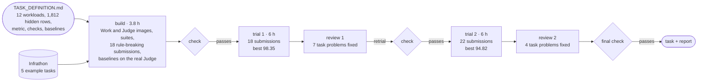
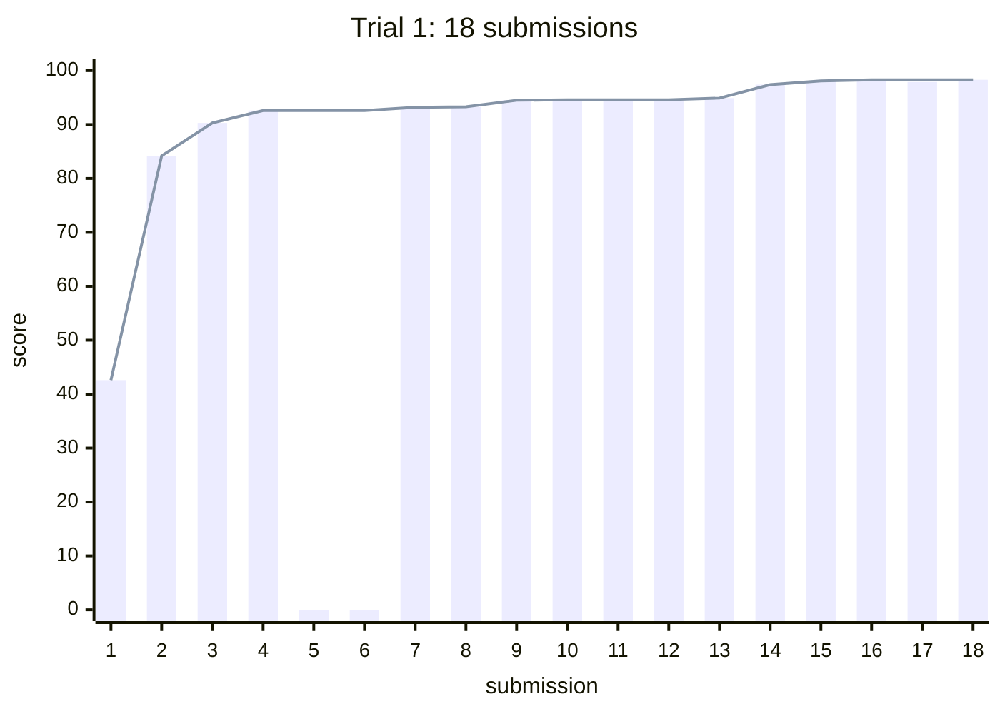
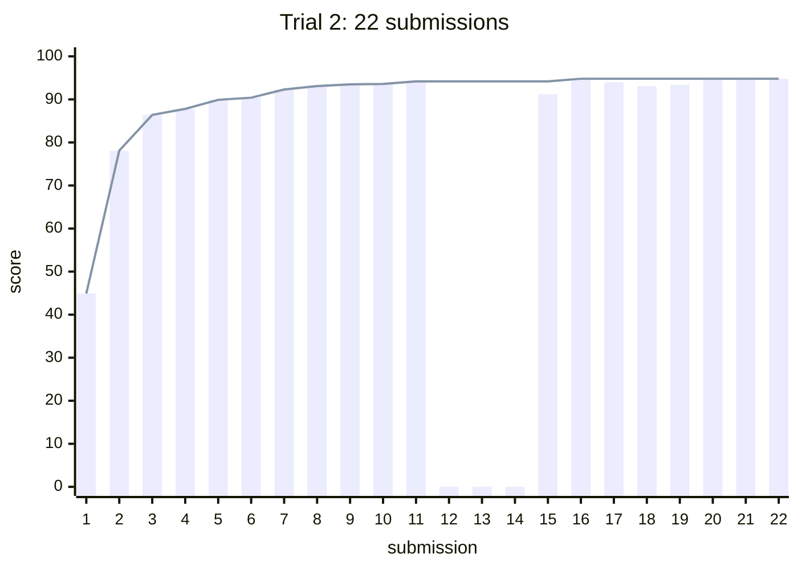

# Example: KVzip KV Scoring for Qwen3-8B

One run of infrathon-build, from an expert's definition to a qualified task. The agent being
measured writes a cheap, query-agnostic scorer that ranks every `(layer, KV head, position)` entry
of Qwen3-8B's KV cache; the Judge keeps the top 10%, 20% and 30% and measures how much answer
quality survives across 1,812 long-context rows.

| | |
|---|---|
| [`input/`](input/) | what the expert handed in: `TASK_DEFINITION.md` and the public attachments |
| [`task/`](task/) | what the run delivered: the task directory and its launcher, ready for Infrathon |
| [`run/`](run/) | how it got there: the full report, both reviews, every trial submission and score |

<p align="center"></p>

## What happened

```mermaid
gantt
    title The run, hours from the start
    dateFormat HH:mm
    axisFormat %H:%M
    todayMarker off
    section Builder agent
    build                 :00:05, 04:42
    review 1              :11:33, 12:47
    review 2              :19:44, 20:38
    section Tool
    setup                 :00:00, 00:05
    check 1               :04:42, 05:12
    check 2               :12:47, 13:16
    final check           :20:38, 21:07
    section Trial agent
    trial 1               :05:18, 11:33
    trial 2               :13:16, 19:44
```





The builder was Claude Code (Claude Opus 5.5, maximum effort); the trial agent was Codex (GPT-6.1
Sol, maximum effort), working six hours per trial through the real launcher, with the LLM integrity
review on.

## What the trials showed

Each bar is one submission's score on the hidden suite (0 when it was rejected); the line is the
best valid score so far.





For scale: on the same Judge, KNorm scores 24.29 and the released Fast KVzip gates 89.25.

The trials were the point. The builder had already passed its own checks, the baselines landed
where the definition expected, and 18 deliberately rule-breaking submissions were all rejected. Yet
the trial agent still found what none of that had:

| | review 1 (after trial 1) | review 2 (after trial 2) |
|---|---|---|
| the Work image named the three hidden-only workloads, and the agent built training data for them: trial 1's 98.35 is inflated, trial 2 without the leak ends at 94.82 | **fixed** | |
| the weights check falsely rejected two honest submissions (a mean of Qwen3 activations correlated with the released gates), and missed padded or raw-byte copies | **fixed** | |
| an undocumented process-memory limit rejected three honest submissions | | **fixed** |
| rejected submissions still returned quality numbers | | **fixed** |
| a trial could not start from a fresh checkout | **fixed** | |
| the brief: run deadline, one submission in flight, version quota, "public tests never produce a score" | **fixed** | **fixed** |
| nothing forbade training on the benchmark's own source datasets | | **new rule** |

Both best submissions are legitimate: per-layer gates on the hidden states that the agent trained
itself, on its own KVzip-style reconstruction targets over public text, plus attention features from
sampled queries; no benchmark data, released weights or token identity. Details are in
[`run/REPORT.md`](run/REPORT.md) and [`run/reviews/`](run/reviews/).

## The integrity review

After the run, the task's integrity policy was rewritten in Infrathon's current policy layout and
calibrated with the real reviewer (Codex, GPT-6.1 Sol) on nine submissions:
[`run/integrity_review.md`](run/integrity_review.md).

## What was delivered

```text
task/
  launch/kvzip-kv-scoring/        run.sh (a benchmark run), check.sh (build, test, baselines through the Judge)
  tasks/latest/kvzip-kv-scoring-qwen3-8b-h100-v2-scratch/
    images/work/                  the agent's brief (AGENT_TASK.md), starting workspace, public tests, runtime
    images/judge/                 the Judge: 7-GPU evaluation, weights detector, all checks
    judge/suite_builder/          rebuilds the public and hidden suites from their sources, frozen by hash
    baselines/                    KNorm and Fast KVzip
    llm_judge/POLICY.md           the integrity policy
    tests/                        unit tests and 19 planted rule-breaking submissions
    README.md                     the task, for maintainers
  task.patch                      the task and launcher as a patch (the run's task-only.patch)
  registry.json                   the task's entries in Infrathon's registries
```

To add it to Infrathon: Infrathon already ships its own KVzip task, whose launcher directory
(`launch/kvzip-kv-scoring/`) has the same name, so apply the patch to a reference export, which
leaves that task out: `python3 reference/make_reference.py --source infrathon --out <dir>`, then
in `<dir>`, `git apply <infrathon-build>/examples/kvzip/task/task.patch`. Add the entries in `registry.json`,
regenerate the task table with `scripts/infrathon/tasks.py table`, put the hidden needles in the
task's `judge/private/` and, since they are your own, record the new suites with the task's
`scripts/build_suites.sh --refreeze`. Then
`launch/kvzip-kv-scoring/check.sh` builds and checks it on eight GPUs, and
`launch/kvzip-kv-scoring/run.sh` runs an agent on it.

Judge-only inputs (the three hidden needles) are not published; see
[`input/attachments/hidden/`](input/attachments/hidden/).

Infrathon's released KVzip task may differ in its details: every run of infrathon-build on a
definition makes its own design decisions, and lists them in its report.
